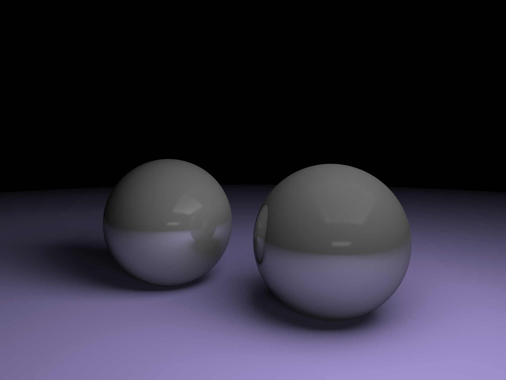

### Ray Tracer

This is a simple realization of a [ray tracing algorithm](https://en.wikipedia.org/wiki/Ray_tracing_(graphics)).




### Local illumination

$$
I(p) = K_a + K_e + al_0 \sum_{m \in lights} (K_dL_d(p, m) + K_sL_s(p, m)) + al_1I_{reflect} + al_2I_{refract}
$$

### Material Library File

```
Ka, ambient color
Ke, emissive color
Kd, diffuse color
Ks, specular color

Ns, specular exponent
Ni, refraction index

al, albedo
```

### Object File

```
S x y z r

v x y z
vn x y z
vt x y z

f v1 v2 v3 ...
f v1/vt1 v2/vt2 v3/vt3 ...
f v1//vn1 v2//vn2 v3//vn3 ...
f v1/vt1/vn1 v2/vt2/vn2 v3/vt3/vn3 ...

P, point light
A, area light
```

### Build Renderer

```bash
$ cmake -B build --fresh --log-level=VERBOSE
$ cmake --build build --parallel
```


### Run Renderer

```bash
$ ./build/rt --cfg=examples/cube.cfg
```
